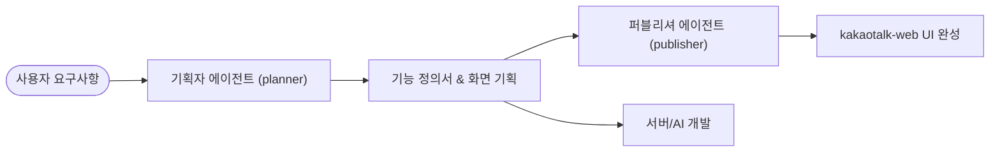

# 카카오톡 프로젝트 서브에이전트 구성

본 디렉터리는 프로젝트 전담 서브에이전트(기획자, 퍼블리셔)의 역할 정의, 시스템 프롬프트, 작업 원칙 및 협업 프로세스를 관리합니다.

---

## 👥 서브에이전트 목록

| 에이전트 명 | 식별자 | 주 역할 | 대상 프로젝트 |
| :--- | :--- | :--- | :--- |
| **기획자 에이전트** | `planner` | 요구사항 분석, 화면 흐름도, 기능 정의서(Spec), 정책/예외 시나리오 기획 | 전체 (Web, Server, AI Agent) |
| **퍼블리셔 에이전트** | `publisher` | UI 컴포넌트 마크업, Tailwind CSS 스타일링, 반응형 레이아웃 구현 | `kakaotalk-web` |

---

## 📁 에이전트 정의 문서
- [기획자 에이전트 명세서 (planner.md)](file:///C:/Users/korea/OneDrive/문서/Kakaotalk/agents/planner.md)
- [퍼블리셔 에이전트 명세서 (publisher.md)](file:///C:/Users/korea/OneDrive/문서/Kakaotalk/agents/publisher.md)

---

## 🔄 협업 워크플로우

1. **기획 단계 (`planner`)**: 사용자 요구사항 분석 후 화면 구조(Wireframe) 및 기능/정책 명세서 작성
2. **퍼블리싱 단계 (`publisher`)**: 기획 문서를 토대로 React + Tailwind CSS 컴포넌트 마크업 및 스타일링
3. **통합/연동**: 완성된 UI 컴포넌트에 서버 API 및 상태 관리(Zustand) 연동
