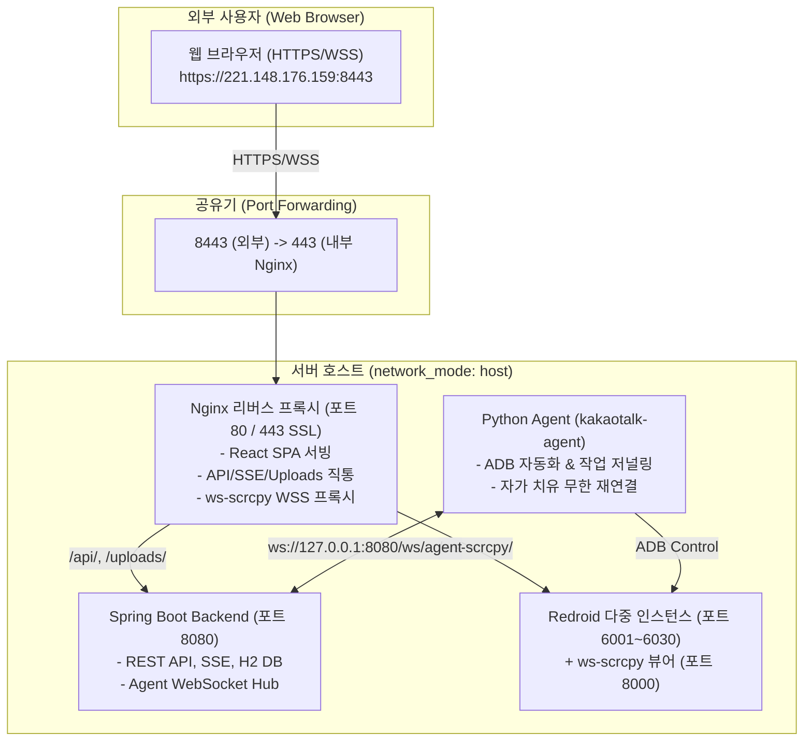

# 🚀 KakaoTalk Automation Infrastructure (`kakaotalk-infra`)

카카오톡 대규모 단말 자동화 및 통합 관리 시스템의 **인프라스트럭처, Docker 오케스트레이션, Redroid 노드 제어 스크립트 및 AI 에이전트 아키텍처** 저장소입니다.

---

## 🏛️ 전체 시스템 아키텍처



---

## 📦 구성 요소 및 서비스 포트

| 서비스 | 컨테이너명 | 주요 역할 | 수신 포트 |
| :--- | :--- | :--- | :--- |
| **kakaotalk-web** | `kakaotalk-web` | React SPA 정적 서빙, Nginx SSL(HTTPS/WSS) 프록시 | `80`, `443` (외부 `8443`) |
| **kakaotalk-server** | `kakaotalk-server` | 중앙 비즈니스 로직, RESTful API, WebSocket 서버 | `8080` |
| **kakaotalk-agent** | `kakaotalk-agent` | ADB 단말 제어, 카카오톡 앱 UI 자동화 스크립트 | 호스트 모드 (`ws/agent` 통신) |
| **ws-scrcpy** | `ws-scrcpy` | WebCodecs/MSE 60 FPS 실시간 단말 화면 스트리밍 | `8000` |
| **Redroid** | `redroid1~N` | 클라우드 안드로이드 11 가상 단말기 인스턴스 | `6001`~`6040` (ADB) |

---

## 🛠️ 빠른 배포 및 실행 가이드

### 1. 배포 사전 준비
```bash
# 레포지토리 클론
git clone https://github.com/ghkdwls30/kakaotalk-infra.git
cd kakaotalk-infra/docker-images
```

### 2. SSL 인증서 설정 (HTTPS 8443)
```bash
# IP 접속용 SSL 인증서가 docker-images/ssl/에 기본 포함되어 있습니다.
# 인증서를 새로 생성하려면:
mkdir -p ./ssl
openssl req -x509 -nodes -days 3650 -newkey rsa:2048 \
  -keyout ./ssl/privkey.pem \
  -out ./ssl/fullchain.pem \
  -subj "/C=KR/ST=Seoul/O=KakaoTalk/CN=221.148.176.159" \
  -addext "subjectAltName = IP:221.148.176.159,IP:127.0.0.1"
```

### 3. Docker Compose 기동
```bash
# 사설 레지스트리에서 최신 이미지 풀 및 기동
docker compose pull
docker compose up -d
```

---

## 📂 디렉토리 구조

```
kakaotalk-infra/
├── .agents/                 # AI 협업 서브에이전트 역할 정의 (planner, publisher, frontend, backend, python, deployer)
├── docker-images/           # 메인 docker-compose 및 배포 설정
│   ├── docker-compose.yml   # 서버, 웹, 에이전트 통합 오케스트레이션
│   └── ssl/                 # SSL 인증서 (fullchain.pem, privkey.pem)
├── scripts/
│   └── redroid/             # WSL2 / Redroid / ws-scrcpy 빌드 및 단말 프로비저닝 스크립트
│       ├── 1_setup_wsl_docker.sh
│       ├── 2_build_binder_kernel.sh
│       ├── 3_build_ws_scrcpy.sh
│       ├── 4_deploy_redroid.sh
│       └── redroid_ctl.sh
├── GEMINI.md                # AI 개발 규칙 및 컨텍스트 가이드
├── README.md
└── .gitignore
```

---

## 🔗 연관 저장소
- [kakaotalk-server](https://github.com/ghkdwls30/kakaotalk-server) : Spring Boot 백엔드
- [kakaotalk-web](https://github.com/ghkdwls30/kakaotalk-web) : React 프론트엔드
- [kakaotalk-agent](https://github.com/ghkdwls30/kakaotalk-agent) : Python ADB 자동화 에이전트
