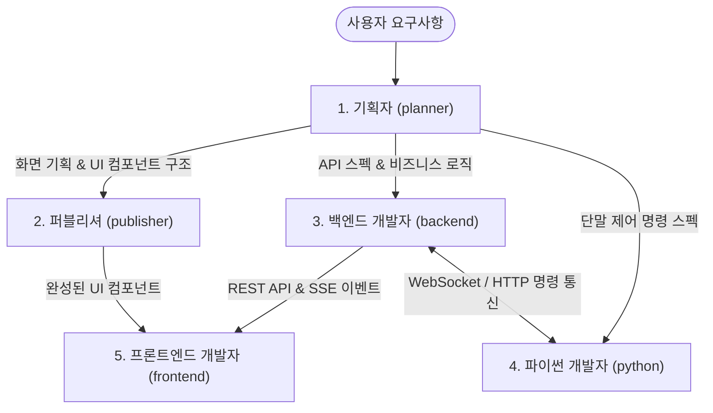

# 카카오톡 프로젝트 서브에이전트 구성

본 프로젝트는 기획부터 퍼블리싱, 풀스택 및 파이썬 단말 자동화까지 전담하는 **5인 서브에이전트 조직**으로 구성되어 있습니다.

---

## 👥 서브에이전트 팀 목록

| 에이전트 명 | 식별자 | 주 역할 | 대상 프로젝트 / 기술 스택 |
| :--- | :--- | :--- | :--- |
| **기획자** | `planner` | 요구사항 정의, 화면 흐름도, 기능 정의서(Spec), 정책/예외 시나리오 | 전체 프로젝트 (Web, Server, Agent) |
| **퍼블리셔** | `publisher` | UI 컴포넌트 마크업, Tailwind CSS 스타일링, 카카오 룩앤필 구현 | `kakaotalk-web` (React, Tailwind CSS) |
| **프론트엔드 개발자** | `frontend` | Zustand 상태 관리, REST API 연동, SSE/WebSocket 실시간 통신 | `kakaotalk-web` (React, TypeScript, Vite) |
| **백엔드 개발자** | `backend` | 도메인 비즈니스 로직, RESTful API, RBAC 보안, MySQL/JPA 설계 | `kakaotalk-server` (Spring Boot, Java, JPA) |
| **파이썬 개발자** | `python` | ADB 단말 제어, 카카오톡 앱 UI 자동화 스크립트, 비동기 작업 저널링 | `kakaotalk-agent` (Python, ADB, asyncio) |

---

## 🔄 엔드투엔드 협업 워크플로우

1. **기획 (`planner`)**: 사용자 요구사항 분석 및 화면 와이어프레임, API 요구사항, 정책 정의
2. **UI 퍼블리싱 (`publisher`)**: 카카오톡 룩앤필 및 Tailwind CSS 반응형 UI 마크업
3. **백엔드 구현 (`backend`)**: Spring Boot REST API, JPA 엔티티, SSE 브로드캐스팅, RBAC 검증
4. **파이썬 자동화 (`python`)**: ADB 디바이스 제어, 카카오톡 안드로이드 앱 자동화 스크립트 개발
5. **프론트엔드 통합 (`frontend`)**: 퍼블리싱 UI에 Zustand 상태, API 통신 및 실시간 이벤트 바인딩
